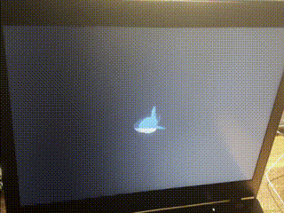

# seabios-gif-bootsplash

## About

The GIF decoder used to achieve this is a modified version of [gifdec](https://github.com/lecram/gifdec)

## Demo

<p align="center">
  
</p>

<p align="center">Demo on a Thinkpad X280</p>

## Usage

Either manually replace `bootsplash.c` or use the provided patch file

```
patch -p1 < seabios-gif-bootsplash.patch
```

The patch file expects that you use it from the coreboot root directory

magick command for converting the GIF (you might have to change the resolution depending on your display)

```
magick in.gif -coalesce -background black -alpha remove -gravity center -extent 1024x768 -strip out.gif
```

Set the GIF in the config as you would set any other bootsplash image, be mindful of the file size

```
CONFIG_BOOTSPLASH_IMAGE=y
CONFIG_BOOTSPLASH_FILE="path/to/bootsplash.gif"
```
